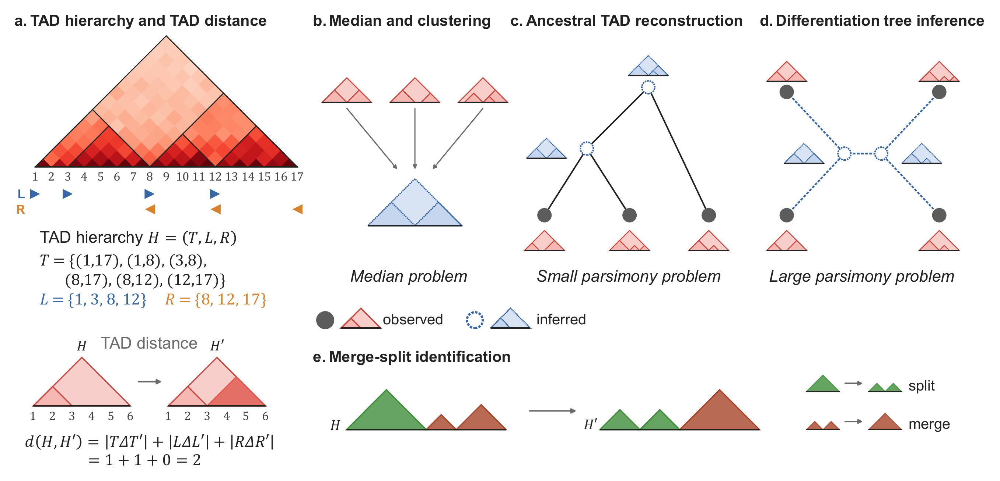

# TADLineage: TAD reorganization across cell states



## Overview

TADLineage models how hierarchies of topologically associating domains (TADs) reorganize as cells
differentiate. **(a)** A TAD hierarchy $H = (T, L, R)$, called from a Hi-C contact map, is represented
by its TADs $T$, their left boundaries $L$ and their right boundaries $R$. Reorganization is a series
of insertions and deletions of TADs and boundaries. The **TAD distance** $d(H, H')$ counts the TADs,
left boundaries and right boundaries present in only one of two hierarchies, and it is a metric.

From the TAD hierarchies of observed cell states, TADLineage solves three problems under this distance:

- **(b) Median.** Find one TAD hierarchy at minimum total distance from a set of hierarchies, with a
  polynomial-time dynamic program. Used as the cluster centre when clustering single cells.
- **(c) Small parsimony.** Given a cell differentiation tree, infer the TAD hierarchies of its unobserved
  (progenitor) cell states by minimizing the total distance over the tree edges. This problem is NP-hard;
  TADLineage solves it exactly with an integer linear program.
- **(d) Large parsimony.** Infer the differentiation tree itself together with the ancestral hierarchies,
  also NP-hard and solved exactly with an integer linear program.

**(e)** TADLineage also identifies a consistent set of TAD **merge** and **split** events between two
hierarchies, in which no TAD takes part in two events, using maximum flow.

The repository contains code only. Hi-C data, TAD calls, intermediate results and figures are not
included.

## Quick start

`tadlineage.py` runs the median, small parsimony, large parsimony and merge–split identification on any
input. It needs Python with
`gurobipy` and a Gurobi license (see [Requirements](#requirements)).

**1. Call TADs from the Hi-C of each cell state.** Any caller that writes one TAD per line as
`start end ...` in 1-based bin indices works. For example, with [OnTAD](https://github.com/anlin00007/OnTAD)
on a dense contact matrix of one chromosome:

```bash
OnTAD/OnTAD/src/OnTAD LT/chr19/1mb/hic_matrix.txt -penalty 0.1 -maxsz 200 -o LT/chr19/1mb/tads
# writes LT/chr19/1mb/tads.tad; repeat for every cell state, same chromosome and bin size
```

**2a. Small parsimony: the tree is known.** Write the tree as an edge list, one `parent child` per line,
and give a TAD file for every observed cell state. Every leaf needs one, and the root can have one
(it is then fixed). Vertices without a TAD file are inferred.

```bash
cat > tree.txt <<'EOF'
LT  MPP
MPP CLP
MPP CMP
CMP MK
CMP G
EOF

python tadlineage.py small --tree tree.txt \
    --tads LT=LT/chr19/1mb/tads.tad CLP=CLP/chr19/1mb/tads.tad \
           MK=MK/chr19/1mb/tads.tad G=G/chr19/1mb/tads.tad \
    --tolerance 1 --out out_small
# -> out_small/MPP.tad, out_small/CMP.tad (inferred), the observed hierarchies as used by the solver,
#    tree_edges.txt and summary.json
```

**2b. Median of a set of hierarchies**, for example cells of one cluster or replicates of one cell type:

```bash
python tadlineage.py median \
    --tads MEP/chr19/1mb/tads.tad MKP/chr19/1mb/tads.tad MK/chr19/1mb/tads.tad \
    --tolerance 1 --out out_median
# -> out_median/median.tad, out_median/summary.json (distance of every input to the median)
```

**2c. Large parsimony: the tree is unknown.** Give the observed hierarchies only. TADLineage returns the
most parsimonious binary tree and the hierarchies of its internal vertices. The root does not change the
cost; `--outgroup` chooses the leaf whose edge carries it (default: the first one).

```bash
python tadlineage.py large \
    --tads LT=LT/chr19/1mb/tads.tad CLP=CLP/chr19/1mb/tads.tad \
           MK=MK/chr19/1mb/tads.tad G=G/chr19/1mb/tads.tad \
    --outgroup LT --tolerance 1 --out out_large
# -> out_large/tree.nwk, e.g. (((G,MK)N5,CLP)N6,LT)root;  plus N5.tad, N6.tad, root.tad,
#    the observed hierarchies, tree_edges.txt and summary.json
```

**3. Merge and split events.** Find the TAD merges and splits between a source and a target
hierarchy, either for one pair or along every edge of a tree, for example the tree reconstructed in
step 2a or 2c:

```bash
# every edge of the reconstructed tree (parent = source, child = target)
python tadlineage.py mergesplit --tree out_small/tree_edges.txt --dir out_small --out out_events

# one pair of hierarchies
python tadlineage.py mergesplit --source CMP/chr19/1mb/tads.tad --target MK/chr19/1mb/tads.tad \
    --tolerance 1 --out out_pair
# -> events.tsv (source, target, split/merge, source TADs, target TADs) and summary.json (counts per edge)
```

A split turns a source TAD `(a,b)` into two target TADs `(a,x)` and `(y,b)` with `x ≤ y`; a merge does
the reverse. Disjoint events are selected by maximum flow, and the remaining changed TADs are counted
as deletions and insertions. For `mergesplit`, `--tolerance N` (default 0) is the number of bins within
which TADs count as shared and event boundaries as equal. This is the implementation used for the
DiffDomain and TADsplimer comparisons (`hemato_cells/diffdomainanalysis_updated/`,
`hemato_cells/tadsplimer/`).

**Options of `small`, `median` and `large`:**

| Option | Meaning |
|---|---|
| `--tolerance N` | Before solving, snap boundaries within `N` bins of each other across the inputs to one position, and drop TADs whose two boundaries both occur in only one input. Recommended 1–2; omit it to use the calls exactly as given. The harmonized inputs are kept in `<out>/harmonized/`. |
| `--Ct`, `--Cb` | Cost of inserting or deleting one TAD (`Ct`) and one boundary (`Cb`); both default to 1. |
| `--mode` | `small` and `large` only: `convex` (default) minimizes `Ct·TADs + Cb·boundaries`; `lex_boundary_first` and `lex_tad_first` minimize one term first, then the other. |

Outputs are `.tad` files with one `start<TAB>end` per line, in the same bins as the input. Every
`summary.json` gives the cost and the number of TAD and boundary changes on each edge. Run one
chromosome and bin size at a time. On a laptop, chromosome 1 at 250 kb (about 80 TADs per cell state)
takes under a second for small parsimony and about 5 seconds for large parsimony with four leaves.

The experiment folders below use the same solvers inside their Snakemake pipelines, with the weighted
variants and the baselines of the paper.

## Repository layout

### Core algorithms (repository root)

| File | Purpose |
|---|---|
| `tadlineage.py` | Command-line entry point (`small`, `median`, `large`, `mergesplit`) on any tree and TAD files; see [Quick start](#quick-start). |
| `tad_sequence.py` | `transform_sequence`: merge and split events between two hierarchies (used by `mergesplit` and the DiffDomain/TADsplimer comparisons). |
| `check_lp_constrained.py` | Small parsimony integer linear program: minimizes TAD changes (`Ct`) plus boundary changes (`Cb`) over the tree edges, with laminarity constraints on the internal nodes. Supports a pinned root, restricting candidate TADs, and imputation at observed nodes. |
| `check_lp_constrained_weighted.py` | The same program with a per-node importance term (used with OnTAD calls). |
| `check_lp_constrained_weighted_updated.py` | Boundary-aware variant that uses per-TAD and per-boundary scores (used with RobusTAD calls). |
| `nussinov*.py` | Nussinov-style dynamic program for the same objective; `nussinov_with_imputation_weighted_fast.py` is the version the clustering pipelines use. |
| `rf_distance_fitch_hartigan.py`, `rf_distance_fitch_hartigan_weigthed.py` | Fitch–Hartigan and Sankoff baselines, treating each TAD as a binary character. |
| `tad_utilities.py` | Reading and writing TAD files, tolerance matching, laminarity checks, relaxed TAD and boundary distances. |
| `filtering.py` | `harmonize_leaf_boundaries`: snaps near-identical boundaries across input files to a shared position. |
| `cluster_sankey.py` | Shared alluvial (Sankey) plotting for cluster-versus-stage comparisons. |

Root-level `check_*.py`, `random_simulation.py` and `boundary_given_case_sim.py` are exploratory
experiments on the integrality of the linear program relaxation (see `SIMULATION_README.md`).

### Experiments

| Folder | Contents |
|---|---|
| `simulation/` | Synthetic Hi-C on a fixed tree. The root `Snakefile` generates contact matrices and the hidden true TADs; `using_ontad/` and `using_robustad/` call TADs and compare the reconstruction methods; `data_quality_sweep/` measures accuracy as resolution and sequencing depth decrease; `tree_informed_tad_inference_{ontad,robustad}/` repairs noisy TAD calls at the leaves using the tree; `tgif_benchmark/` compares against TGIF-DB. |
| `hemato_cells/` | Mouse hematopoietic lineage (LT-HSC → MPP → {CLP, CMP → …}). `using_ontad/` and `using_robustad/` reconstruct MPP and CMP and score them; `large_parsimony/` infers the lineage tree from the observed cell types; `tad_pathway_analysis/` runs gene set enrichment on reorganized TADs; `diffdomainanalysis*/` and `tadsplimer/` cross-check merge and split calls against external tools. |
| `scptr_robustad/`, `scptr_ontad/` | Single-cell Hi-C of early mouse embryos (1- to 64-cell stages): EM clustering of cells by TAD distance, median TAD hierarchies per cluster, and trees over the medians. `scptr_robustad/merge_split_real_biology/` analyzes merge, split and boundary events between stages. |
| `higashi_scptr/`, `schiccluster_scptr/`, `schicptr_scptr/` | Baselines on the same embryo data: Higashi, scHiCluster and scHiCPTR. |
| `robustad_predictions*/`, `refhic_predictions/`, `mouse_neuron/`, `scptr/` | TAD calling runs and data preparation for the datasets above. |

Most folders have their own `README.md` with a single-case example.

## Conventions

- **Intervals** are written `"[a,b]"` in files and held as `(a, b)` tuples in memory. Coordinates are
  1-based **bin indices**, not base pairs.
- **TAD files** follow `<NODE>/chr<C>/<RESOLUTION>/tads.tad` (for example `MEP/chr1/500kb/tads.tad`),
  with `boundaries.bed` alongside when the caller reports boundary scores. Harmonized and imputed
  variants are `tads_filtered.tad` and `tads_filtered_imputed.tad`.
- **`--tolerance`** (in bins) means the same thing everywhere: two boundaries within the tolerance are
  treated as one boundary, both for harmonization and for scoring.
- The reconstruction methods compared throughout are `given_root` (TADLineage), `given_root_weighted`
  (weighted TADLineage), `rf` (Fitch–Hartigan), `rf_weighted` (Sankoff), `union` and `intersection`.
  In the simulation folders `given_root_weighted` is a deliberately biased baseline that uses the
  held-out truth to calibrate its weights; every other method is scored without access to the truth.

## Requirements

Different steps need incompatible environments, so scripts and Snakefiles call interpreters by
absolute path (`PYTHON = ...` at the top of each Snakefile). Adjust these paths for your machine.

| Environment | Used for |
|---|---|
| Snakemake, Gurobi (`gurobipy`), pandas, matplotlib, seaborn | Workflows, every integer linear program, plotting. A Gurobi license is required. |
| `cooler` | RobusTAD and RefHiC TAD calling |
| OnTAD | OnTAD TAD calling |
| Higashi, scHiCluster, scHiCPTR, TADsplimer | The corresponding baselines |

Third-party tools (RobusTAD, RefHiC, OnTAD, Higashi, scHiCluster, scHiCPTR, TADCompare, dcHiC,
diffDomain, TADsplimer, Juicer, TGIF) are not vendored. Clone them into the repository root; scripts
that use RobusTAD add `<repo>/RobusTAD` to `PYTHONPATH`.

## Running a workflow

Each experiment folder has its own `Snakefile` and is run from inside that folder, for example

```bash
cd simulation/using_ontad
snakemake --cores 8 -p --rerun-incomplete
```

Folders with several workflow files (`Snakefile_methods`, `Snakefile_updated`,
`check_intermediate_*_snakemake`) are selected with `-s`. Cap `--cores` at about 4 for jobs that run
many Gurobi solves at once. Every script is also an argparse command-line tool and can be run directly.

Some pipelines run in two stages (`--stage call` in the TAD caller's environment, then `--stage score`
in the Gurobi environment). Both stages rebuild the same synthetic truth from the same seed, so they
must receive identical simulation parameters.

## Known pitfalls

- **Snakemake late binding.** Rules are written out one by one rather than generated in a Python
  `for` loop. A loop-generated rule with a bare-variable `shell:` body runs the last iteration's
  command for every rule.
- **Determinism across stages.** Seeds use `zlib.crc32(name)`, never Python's `hash()`, which is salted
  per process.
- **Imputation cost.** With `impute=True`, `impute_cost` must be positive; otherwise the solver adds an
  interval to a parent and all its children at no cost and floods every leaf.
- **Genome assembly.** `genome.chrom.sizes` holds mm9 chromosome lengths, but the single-cell embryo
  data are mm10. Genome-wide ("all") runs that lay chromosomes end to end with this file misplace
  contacts and TADs near the ends of chromosomes that are longer in mm10.
